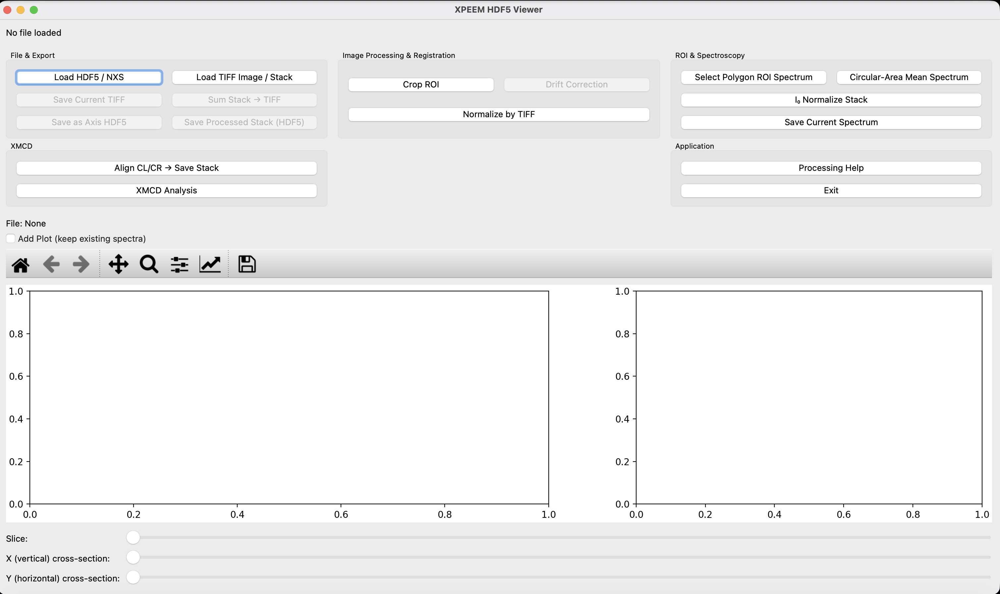

# XPEEM Viewer

**XPEEM Viewer** is a Python-based graphical application for visualisation, processing, alignment, and analysis of X-ray PhotoEmission Electron Microscopy (XPEEM) image stacks.

The software was developed for practical analysis of XPEEM datasets, with particular emphasis on spectromicroscopy, drift correction, and XMCD workflows.

---

## Main features

- Load and visualise HDF5/NXS image stacks
- Load and save TIFF images and stacks
- Navigate energy-dependent and time-dependent image stacks
- Extract spectra from user-defined regions of interest (ROI)
- Normalise image stacks using I0 spectra
- Sum selected images or complete stacks
- Save processed stacks back to HDF5
- Align image stacks using drift correction
- Compare two drift-correction approaches:
  - Phase cross-correlation
  - Igor/SPELEEM-style FFT correlation
- Align circular-left (CL) and circular-right (CR) polarisation images
- Calculate and visualise XMCD contrast
- Built-in processing and workflow help

---

## Intended use

XPEEM Viewer is intended as a practical analysis tool for XPEEM users who need to inspect and process microscopy and spectromicroscopy datasets without constructing an analysis workflow from individual Python scripts.

The graphical interface is designed to make common processing operations accessible while retaining the possibility of reproducible data processing and export.

---

## Screenshot

---

## Drift correction

XPEEM Viewer currently provides two complementary approaches for translational drift correction.

### Phase cross-correlation

The current drift-correction implementation uses phase cross-correlation and provides:

- subpixel registration
- fixed-reference alignment
- sequential alignment
- rolling-reference alignment
- full-image or ROI-based registration
- optional image preprocessing

This approach is suitable as the standard drift-correction method for most datasets.

### Igor/SPELEEM-style FFT correlation

A second drift-correction procedure is based on the historical Igor Pro/SPELEEM processing workflow.

It uses FFT-based image cross-correlation together with options for:

- ROI-based registration
- image interpolation
- intensity, edge, or sharpened preprocessing
- sine-window weighting
- progressive reference updating
- iterative refinement
- second-pass correction

Both procedures are retained so that their behaviour can be compared on XPEEM datasets.

---

## Installation

The recommended installation uses a dedicated Conda environment.

### 1. Create the environment

    conda create -n xpeem-viewer python=3.12 -y

### 2. Activate the environment

    conda activate xpeem-viewer

### 3. Install the dependencies

From inside the XPEEM-Viewer directory:

    pip install -r requirements.txt

### 4. Start XPEEM Viewer

    python xpeem_viewer.py

For detailed installation instructions, including Windows setup and troubleshooting, see:

**[INSTALLATION.md](INSTALLATION.md)**

---

## Dependencies

The main dependencies are:

- Python 3.12
- NumPy
- SciPy
- h5py
- PySide6
- Matplotlib
- scikit-image
- Pillow

The required packages are listed in `requirements.txt`.

---

## Quick start

Activate the environment:

    conda activate xpeem-viewer

Navigate to the XPEEM Viewer directory:

    cd <PATH-TO-XPEEM-VIEWER>

Start the viewer:

    python xpeem_viewer.py

Then use **Load HDF5 / NXS** or the TIFF loading functions to open an XPEEM dataset.

---

## Typical processing workflows

### Spectromicroscopy

A typical spectroscopy workflow is:

1. Load an HDF5/NXS image stack.
2. Inspect the stack using the image navigation controls.
3. Define a region of interest.
4. Extract the mean spectrum from the ROI.
5. If required, define an I0 region and normalise the stack.
6. Save processed data or spectra for further analysis.

### Drift correction

A typical drift-correction workflow is:

1. Load an image stack.
2. Open the drift-correction interface.
3. Select either phase cross-correlation or Igor/SPELEEM-style FFT correlation.
4. Select the registration parameters.
5. Define a registration ROI if required.
6. Calculate and inspect the drift.
7. Apply the correction.
8. Save the aligned stack.

### XMCD

A typical XMCD workflow is:

1. Load the CL and CR datasets.
2. Normalise the datasets as required.
3. Align the corresponding CL and CR images.
4. Calculate the XMCD contrast.
5. Inspect and export the resulting images.

Detailed workflow documentation is also available through **Processing Help** inside the application.

---

## Supported data

The viewer is primarily designed for:

- HDF5
- NeXus/NXS
- TIFF images
- TIFF image stacks

The exact internal organisation of HDF5/NXS files can vary between instruments and acquisition systems. The current reader includes support for the data structures used during development and testing of XPEEM Viewer.

---

## Windows use

A Windows launcher is included:

    launch_xpeem_viewer.bat

After installation, the launcher can be used to start XPEEM Viewer without manually entering the Python command each time.

See `INSTALLATION.md` for details.

---

## Updating

If the repository was cloned using Git:

    git pull

Then activate the environment:

    conda activate xpeem-viewer

and update the dependencies if necessary:

    pip install -r requirements.txt

---

## Development status

XPEEM Viewer is under active development.

The software has been developed around practical XPEEM data-processing requirements. New functionality and changes should therefore be validated against representative experimental datasets before being incorporated into stable releases.

---

## Repository structure

    XPEEM-Viewer/
    |
    |-- README.md
    |-- INSTALLATION.md
    |-- requirements.txt
    |-- xpeem_viewer.py
    |-- launch_xpeem_viewer.bat
    |
    |-- docs/
    |   |-- images/
    |
    |-- examples/

Additional documentation and example datasets may be added as the project develops.

---

## Contributing

Suggestions, bug reports, and contributions are welcome.

When reporting a problem, please provide:

- operating system
- Python version
- XPEEM Viewer version
- description of the dataset type
- steps needed to reproduce the problem
- complete error message or traceback, if available

Please avoid uploading unpublished or confidential experimental datasets to public GitHub issues.

---

## Citation

A formal citation for XPEEM Viewer will be added as the software develops.

If you use the software for scientific work, please acknowledge XPEEM Viewer and the relevant experimental facility/instrument according to the applicable facility guidelines.

---

## License

A software license will be specified before the first public release.

---

## Author

**Sufal Swaraj**  
Synchrotron SOLEIL  
HERMES Beamline
